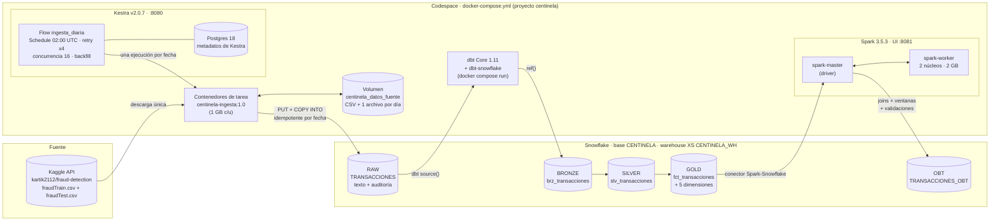

# Arquitectura del pipeline

> Nota del proyecto final: copia de la evidencia del PSet 2 (`pset_2/docs/`, tag `pset-02`). Los enlaces apuntan a los archivos de `proyecto_final/`; `backfill_paralelo.sh` y `flows/ingesta_diaria.yml` se reemplazaron por `kestra/ingesta.yml` en la fase 1 (`docs/cambios.md`) y los enlaces a ellos llevan a su versión original en `pset_2/`.

## Diagrama

Para exportarlo a PNG: pega el bloque en <https://mermaid.live> y descárgalo, o mira la vista previa de GitHub del archivo.

## Flujo de datos

1. **Fuente → Kestra.** El flow `centinela.ingesta.ingesta_diaria` corre una vez por día (`Schedule` a las 02:00 UTC) y carga **una fecha**. La primera ejecución descarga el dataset de Kaggle **una sola vez** al volumen `centinela_datos_fuente` y lo divide en un archivo por día. Ver [`ingesta.md`](ingesta.md).
2. **Kestra → RAW.** Cada ejecución levanta un contenedor `centinela-ingesta:1.0` que hace `PUT` del archivo del día a un stage interno y `COPY INTO RAW.TRANSACCIONES` dentro de una transacción. Si la fecha ya tenía filas, primero las borra (idempotente). Todo se guarda como texto, más `_SOURCE_FILE`, `_LOAD_DATE` e `_INGESTED_AT`.
3. **RAW → BRONZE → SILVER → GOLD (dbt).** `docker compose run --rm dbt build`:
   - BRONZE tipa y normaliza nombres (1:1 con RAW);
   - SILVER limpia según el diagnóstico de calidad;
   - GOLD arma el star schema;
   - 67 tests validan claves, relaciones y reglas de negocio.

   Ver [`calidad_datos.md`](calidad_datos.md) y [`modelo_dimensional.md`](modelo_dimensional.md).
4. **GOLD → OBT (Spark).** `bash spark/ejecutar_obt.sh` lee GOLD con el conector Spark–Snowflake, une el hecho con las dimensiones, calcula variables de comportamiento por cliente sin fuga de información, valida conteos y escribe `OBT.TRANSACCIONES_OBT`. Ver [`obt.md`](obt.md).

## Decisiones de infraestructura

| Decisión | Por qué |
|---|---|
| Snowflake con un **usuario de servicio** (`TYPE = SERVICE`) y **par de llaves** | Snowflake restringe los inicios de sesión solo con contraseña. El mismo usuario y la misma llave sirven a Kestra, dbt y Spark, con un rol de permisos mínimos ([`snowflake/01_setup.sql`](../../snowflake/01_setup.sql)) |
| Warehouse XS con `AUTO_SUSPEND = 60` y resource monitor de 15 créditos al mes | La carga es pequeña (~2.500 filas por día) y el monitor pone un tope de gasto |
| Kestra ejecuta las tareas en **contenedores aparte** con una imagen propia | Dependencias fijas (`snowflake-connector-python` 4.8.0, `kaggle` 2.2.5), aisladas de Kestra y con límite de memoria por tarea |
| dbt en Docker con `profiles: ["tools"]` | No ocupa memoria mientras no corre. Versión fija (dbt-core 1.11.16 + dbt-snowflake 1.11.6) sin tocar el `requirements.txt` del curso |
| Spark con la imagen oficial `apache/spark:3.5.3` | Misma versión que el `pyspark` del curso. Se evitan las imágenes de Bitnami, que dejaron de publicarse gratis |
| Secretos fuera de git | `.env` (Compose, dbt, Spark) y `.env.kestra` (`SECRET_*` en base64 para Kestra) están ignorados. Solo se versiona `.env.example`, con valores ficticios |
| Límites de memoria por servicio | El pico calculado es de ~9,5 GB en la máquina de 16 GB (detalle en el [README](../../README.md)) |

## Batch frente a streaming

**Decisión: batch diario.** Streaming no se implementa.

**Por qué alcanza con batch hoy:**
- **Frecuencia de la fuente:** el dataset es un archivo estático. En el escenario simulado, el banco consolida las transacciones del día y las publica una vez al día (~2.500 transacciones diarias en promedio, 1,85 M en dos años).
- **Latencia que necesita el problema en esta etapa:** el pipeline del PSet 2 alimenta el **entrenamiento, la evaluación y el monitoreo** del modelo (PSets 3 y 4). Esas decisiones se toman por semanas o meses (comparar con las reglas fijas, ajustar umbrales, reentrenar mensualmente). Que los datos lleguen con un día de retraso no les quita valor.
- **Costo y complejidad:** un `COPY` diario de un archivo es simple, idempotente y barato (el backfill de 731 días tomó ~11 minutos). Un sistema de streaming exigiría un broker, consumidores siempre encendidos, manejo de eventos tardíos y desduplicación en línea, sin beneficio para el entrenamiento.
- **Las variables de comportamiento no dependen del modo de ingesta:** se calculan con ventanas "solo pasado" en Spark sobre el histórico. El mismo cálculo valdría con datos llegados en streaming.

**Qué tendría que cambiar para justificar streaming:**
- Que el pipeline pase a **alimentar la decisión en línea**: puntuar cada transacción **en el momento de la autorización** (milisegundos) para aprobar, verificar o retener, que es la acción final que propone Centinela. Ahí, un dato de hace un día sí pierde valor: la ventana de "transacciones en la última hora" tiene que incluir las de hace 5 minutos.
- Que la fuente sea un **flujo de eventos** (autorizaciones que llegan una a una desde el core bancario) y no un archivo diario.
- Que existan **features en línea** (conteos de 1 h o 24 h por tarjeta, actualizados con cada evento) y un *feature store* que sirva el mismo cálculo al entrenamiento y a la inferencia, para evitar diferencias entre los dos.
- Que haya un SLA de latencia y volumen que lo justifique (por ejemplo, decisiones en menos de 100 ms con miles de transacciones por segundo).

Incluso en ese escenario, el batch seguiría existiendo para el reentrenamiento y la evaluación histórica (arquitectura lambda/kappa). Solo la ruta de inferencia sería streaming.
