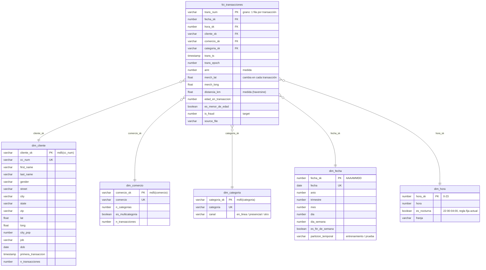

# Transformaciones con dbt y modelo dimensional (GOLD)

## Capas

| Capa | Modelo | Filas | Qué hace |
|---|---|---|---|
| RAW (`source`) | `RAW.TRANSACCIONES` | 1.852.394 | Datos tal como llegan (todo texto + auditoría), cargados por Kestra |
| BRONZE | [`brz_transacciones`](../dbt/models/bronze/brz_transacciones.sql) | 1.852.394 | Copia 1:1 con **tipos correctos** (timestamp, number, float, date) y nombres normalizados. Sin reglas de negocio |
| SILVER | [`slv_transacciones`](../dbt/models/silver/slv_transacciones.sql) | 1.852.394 | Limpieza ([`calidad_datos.md`](calidad_datos.md)): deduplicación por `trans_num`, quita `fraud_`, completa `zip` a 5 dígitos, filtros de validez y derivadas sin fuga (edad en la transacción, hora, día de la semana, época, distancia haversine) |
| GOLD | `fct_transacciones` + 5 dimensiones | ver abajo | Star schema |

Dependencias solo con `source()` (BRONZE → RAW) y `ref()` (el resto). Cada capa escribe en su esquema de Snowflake (`BRONZE`, `SILVER`, `GOLD`) gracias a [`macros/generate_schema_name.sql`](../dbt/macros/generate_schema_name.sql). Todas se materializan como tablas (el `dbt build` completo tarda ~12 s en un warehouse XS).

SILVER tiene las mismas filas que BRONZE porque el diagnóstico encontró **0 duplicados y 0 filas inválidas**. Las reglas quedan implementadas y probadas para cargas futuras.

## Grano del hecho

**`fct_transacciones`: una fila por transacción con tarjeta (`trans_num`)**. Es la unidad de predicción definida en el PSet 1: el modelo puntúa cada transacción en el momento de la autorización.

## Star schema

| Tabla | Filas | Por qué existe |
|---|---|---|
| `fct_transacciones` | 1.852.394 | Hechos medibles de cada transacción y el target |
| `dim_cliente` | 999 | Atributos estables por tarjeta. El diagnóstico mostró 0 cambios por `cc_num` (SCD tipo 1, verificado con un test) |
| `dim_comercio` | 693 | Comercio sin el prefijo `fraud_`. No lleva ubicación ni categoría (ver [`calidad_datos.md`](calidad_datos.md)) |
| `dim_categoria` | 14 | Categoría de la transacción y su canal (`_net` en línea, `_pos` presencial) |
| `dim_fecha` | 731 | Calendario completo 2019-2020, con la partición temporal del PSet 1 (entrenamiento hasta jun-2020, prueba desde jul-2020) |
| `dim_hora` | 24 | Hora del día y la franja nocturna (22:00–04:00) de la regla fija que el proyecto quiere superar |

**Decisiones de diseño verificadas con datos:**
- La ubicación del comercio va en el **hecho**: cambia en cada transacción en los 693 comercios.
- La categoría es una **dimensión propia**: 7 comercios tienen más de una.
- Las claves sustitutas son `md5()` de la clave natural. Son deterministas: las mismas en cada `dbt build`, sin depender del orden de carga.

## Tests (67 tests + 8 modelos = 75 nodos en `dbt build`)

| Tipo | Tests |
|---|---|
| `unique` + `not_null` en claves | `trans_num` (SILVER y hecho); `cliente_sk`, `cc_num`, `comercio_sk`, `comercio`, `categoria_sk`, `categoria`, `fecha_sk`, `fecha`, `hora_sk` |
| `relationships` | El hecho contra **las 5 dimensiones** (`fecha_sk`, `hora_sk`, `cliente_sk`, `comercio_sk`, `categoria_sk`) |
| `accepted_values` | `is_fraud` ∈ {0, 1} en BRONZE, SILVER y el hecho; `gender` ∈ {F, M}; `canal`; `particion_temporal` |
| Reglas de negocio, con el test genérico propio [`valor_entre`](../dbt/tests/generic/valor_entre.sql) | `amt` > 0; edad en la transacción entre 10 y 100; distancia entre 0 y 20.000 km; hora entre 0 y 23 |
| Reglas de negocio (tests singulares en [`dbt/tests/`](../dbt/tests/)) | `bronze_conteo_igual_a_raw` (BRONZE es 1:1); `silver_conteo_igual_a_trans_num_distintos` (la limpieza solo quita duplicados e inválidos); `gold_conteo_igual_a_silver` (el hecho conserva el grano); `silver_fechas_en_2019_2020`; `silver_merchant_sin_prefijo_fraud`; `silver_zip_cinco_digitos`; `gold_tasa_fraude_plausible` (tasa entre 0,1 % y 2 %); `gold_cliente_sin_cambios_de_atributos` (supuesto SCD 1 de `dim_cliente`) |
| Sobre la fuente | `not_null` de `trans_num` y `_load_date` en RAW |

**Resultado** (`docker compose run --rm dbt build`, 2026-11-16 01:15 UTC): **`PASS=75 WARN=0 ERROR=0 SKIP=0`**. La salida completa está en [`dbt_build_resultado.txt`](dbt_build_resultado.txt).

Ajuste respecto al diseño inicial: el rango de edad propuesto era 18–100. El diagnóstico encontró 21.847 transacciones (1,18 %) de titulares de 13 a 17 años, así que la regla quedó en 10–100, con el indicador `es_menor_de_edad` en el hecho.

## Capturas para el documento

1. **Snowsight → Data → Databases → CENTINELA**, con los esquemas `RAW`, `BRONZE`, `SILVER`, `GOLD` y `OBT` desplegados y sus tablas.
2. **Terminal** con el final de `docker compose run --rm dbt build` (`PASS=75 WARN=0 ERROR=0`).
3. Opcional: `docker compose run --rm -p 8082:8080 --entrypoint sh dbt -c "dbt docs generate && dbt docs serve --port 8080 --host 0.0.0.0"`. Después abre el puerto 8082 en Ports y captura el grafo de linaje (*lineage graph*).
